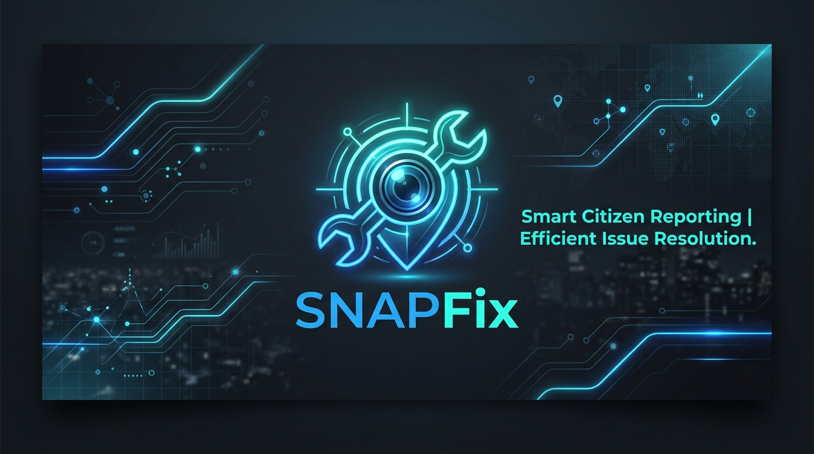
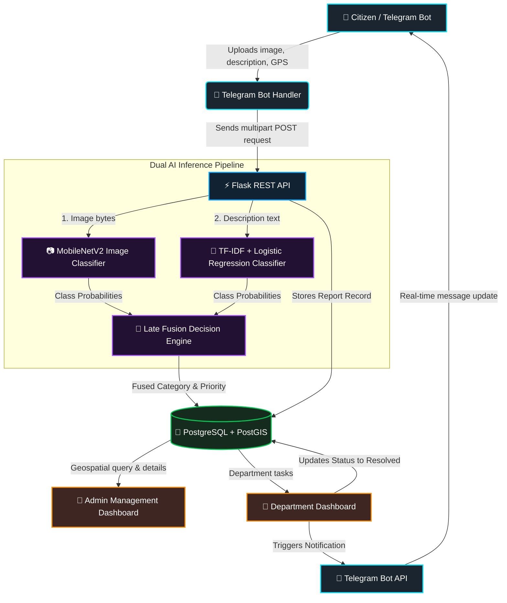

<h1 align="center">🚨 SnapFix</h1>

<p align="center">
  <strong>An AI-powered smart citizen reporting and civic management system.</strong>
</p>

<p align="center">
  <a href="https://python.org"></a>
  <a href="https://flask.palletsprojects.com/"></a>
  <a href="https://tensorflow.org"></a>
  <a href="https://scikit-learn.org"></a>
  <a href="https://postgresql.org"></a>
  <a href="https://postgis.net"></a>
  <a href="https://core.telegram.org/bots"></a>
</p>

---

## 🌟 What is SnapFix?

**SnapFix** is a complete, civic tech platform that empowers citizens to report local issues (like potholes, garbage, waterlogging, or damaged electricity poles) directly via a **Telegram Bot**. 

By leveraging a **Dual-AI Inference Engine** (Computer Vision + Natural Language Processing) with **Late Decision Fusion**, SnapFix automatically:
1. Classifies the issue category.
2. Infers its priority level based on classification confidence.
3. Routes the report to the corresponding municipal department.
4. Allows admins and department operators to track, update, and resolve complaints via web-based dashboards while notifying citizens in real-time.

---

## 🏗️ System Architecture

The following diagram illustrates the lifecycle of a complaint from its report on Telegram, through the backend classifiers, database storage, and municipal resolution.



---

## 🛠️ Key Features

- **📸 Instant Photo & Text Reporting**: Citizens can snap a photo, add a brief description, and attach their live GPS location.
- **🧠 Late-Fusion AI Classifier**: Combines Computer Vision (`MobileNetV2` trained via transfer learning) with NLP (`TF-IDF + Logistic Regression`) for double-checked accuracy.
- **🗺️ PostGIS Geospatial Support**: Uses spatial database tables to record geographic coordinates for heatmaps and proximity-based analytics.
- **👮 Dedicated Admin Panel**: Administrators can view incoming reports, track issue status, and assign tasks to department heads.
- **🔧 Municipal Department Dashboard**: Department admins log in, see assigned issues, and update resolution progress (which automatically alerts the citizen via Telegram).

---

## 📂 Project Anatomy

```bash
├── assets/
│   └── snapfix_banner.jpg          # Repository header banner
├── data/
│   └── images/                     # Folder containing train/valid/test image datasets
├── model_output/
│   └── image_model_mobilenet.keras # Pre-trained Keras image classification model
├── templates/                      # Jinja2 HTML templates for Flask dashboards
│   ├── base.html
│   ├── home.html
│   ├── admin_reports.html          # Web panel for central admins
│   ├── dept_login.html             # Login panel for department admins
│   ├── dept_dashboard.html         # Workspace for department admins
│   └── dept_report_detail.html     # Ticket detail & status updating page
├── tests/                          # Testing scripts for evaluation & recall
├── app.py                          # Main Flask server (API routes & Dashboards)
├── arc.md                          # Simple mermaid architecture script
├── complaints_text_dataset.csv     # Dataset for text classifier training
├── fusion.py                       # Late-decision fusion algorithms
├── image_model.py                  # Image loader & preprocess routines
├── telegram_bot.py                 # Telegram Bot client daemon
├── train_image_model.py            # Script to train/fine-tune MobileNetV2
├── train_text_model.py             # Script to train Scikit-learn text model
├── split_images.py                 # Helper to split image datasets
└── generate_text_dataset.py        # Helper to generate test mock text reports
```

---

## ⚙️ Getting Started & Local Setup

### 1. Prerequisites & Environment Setup

Clone the repository and install the required dependencies:

```bash
pip install flask flask-cors psycopg2 numpy tensorflow Pillow python-telegram-bot python-dotenv scikit-learn joblib
```

Create a `.env` file in the root directory:

```env
TELEGRAM_BOT_TOKEN="YOUR_TELEGRAM_BOT_TOKEN"
BACKEND_URL="http://127.0.0.1:5000"
```

### 2. Database Schema Configuration
Ensure you have **PostgreSQL** installed and running. Create a database named `SnapFix`, then execute the following SQL script to set up the schemas and populate municipal department login credentials:

```sql
-- 1. Create Database
CREATE DATABASE "SnapFix";

-- Connect to your database
\c SnapFix;

-- 2. Enable PostGIS Extension (Optional, but recommended for Geospatial capabilities)
CREATE EXTENSION IF NOT EXISTS postgis;

-- 3. Create Department Admins Table
CREATE TABLE dept_admins (
    id SERIAL PRIMARY KEY,
    username VARCHAR(100) UNIQUE NOT NULL,
    password VARCHAR(100) NOT NULL,
    department VARCHAR(255) NOT NULL
);

-- 4. Create Reports Table
CREATE TABLE reports (
    id SERIAL PRIMARY KEY,
    tracking_id VARCHAR(50) UNIQUE,
    userId INTEGER DEFAULT 0,
    issueType VARCHAR(100) NOT NULL,
    location VARCHAR(255),
    description TEXT,
    priority VARCHAR(50) DEFAULT 'Medium',
    status VARCHAR(50) DEFAULT 'Pending',
    telegram_id BIGINT,
    primary_department VARCHAR(255),
    decision_source VARCHAR(100),
    probability NUMERIC(4, 2),
    raw_label VARCHAR(100),
    latitude DOUBLE PRECISION,
    longitude DOUBLE PRECISION,
    remarks TEXT,
    dept_status VARCHAR(100) DEFAULT 'Not Assigned',
    dept_remarks TEXT,
    timestamp TIMESTAMP DEFAULT CURRENT_TIMESTAMP,
    assigned_dept_admin_id INTEGER REFERENCES dept_admins(id)
);

-- 5. Seed Initial Department Admins (Password: admin123)
INSERT INTO dept_admins (username, password, department) VALUES
('pwd_admin', 'admin123', 'Public Works Department (PWD)'),
('rto_admin', 'admin123', 'Transport Department (RTO / Traffic Engineering)'),
('swm_admin', 'admin123', 'BBMP – Solid Waste Management (SWM)'),
('bescom_admin', 'admin123', 'BESCOM (Electricity Supply Company)'),
('traffic_admin', 'admin123', 'Traffic Police (Bengaluru Traffic Police)');
```

### 3. Model Training (Optional)
If you wish to re-train or train the model artifacts from scratch, execute:

```bash
# Train the Text Classifier (creates text_vectorizer.joblib & text_classifier.joblib)
python train_text_model.py

# Train the Image Classifier (saves image_model_mobilenet.keras)
python train_image_model.py
```

### 4. Running the Applications

#### Start the Flask Backend Server
The server hosts both the REST API endpoint `/api/classify` used by the bot, and the Web Dashboards.
```bash
python app.py
```
*Dashboards will be available at `http://127.0.0.1:5000/admin/reports` (Central Admin Panel) and `http://127.0.0.1:5000/dept/login` (Department Login).*

#### Start the Telegram Bot Daemon
In a separate terminal window, launch the Telegram Bot client:
```bash
python telegram_bot.py
```
*Open Telegram, search for your bot, and send `/start` to start reporting issues!*

---

## 🤖 Late Fusion AI Pipeline

SnapFix leverages a **Late Fusion** mechanism detailed in `fusion.py`. Rather than relying solely on images or text, the classification scores are processed together:

| Case | Decision Rule | Confidence Shift | Source Label |
| :--- | :--- | :--- | :--- |
| **Image & Text Agree** | Keeps class | **Boosted (+15%)** | `image_text_agree` |
| **Image & Text Disagree** | Prefers Text | **Damped (-20%)** | `text_primary_image_disagree` |
| **Text Only** | Keeps class | Unchanged | `text_only` |
| **Image Only** | Keeps class | Unchanged | `image_only` |

> [!NOTE]
> If the final confidence score falls below **0.50 (50%)**, the pipeline flags the issue category as `needs_manual_review` so an administrator can manually assign it to the correct department.
